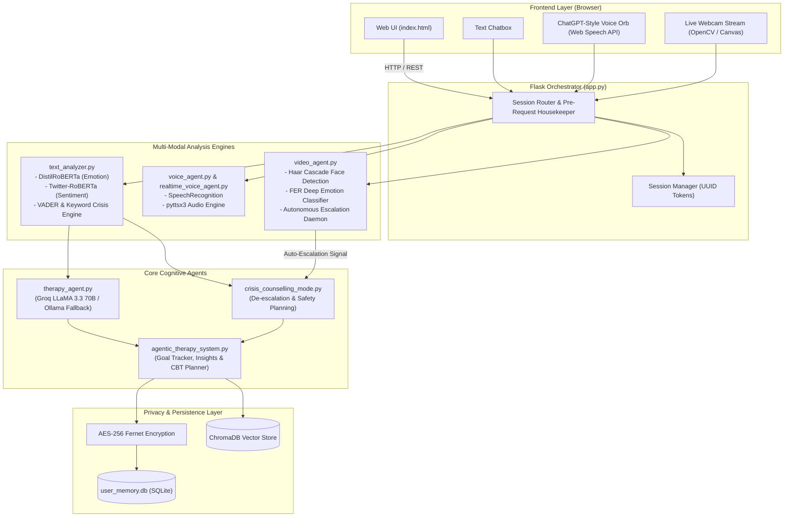

# 🧠 Knowledge Transfer (KT) Guide: Multi-Modal Agentic AI Therapy System
**Author & System Architect:** [Aayushy7777](https://github.com/Aayushy7777)  
**Version:** 2.0.0  
**Project:** Agentic AI for Personalized Mental Health Therapy Recommendations via Multi-Modal Sentiment Analysis  

---

## 📌 1. Executive Summary & Problem Statement

Traditional mental health chatbots rely almost exclusively on simple text sentiment, missing critical non-verbal cues such as facial micro-expressions and voice intonation. Additionally, standard LLMs lack stateful memory, long-term therapeutic goal tracking, and immediate, autonomous crisis response protocols.

This project delivers an **autonomous, privacy-first, multi-modal agentic mental health platform**:
- **Multi-Modal Sensing:** Synchronously or asynchronously processes **Text**, **Voice**, and **Live Video** to gauge emotional states across 7 primary emotional dimensions.
- **Autonomous Agentic Architecture:** Tracks emotional trends over time (e.g., 5 continuous minutes of intense sadness or anger) and autonomously escalates the user into a specialized Crisis Counseling Mode.
- **Stateful Memory & Vector Store:** Employs ChromaDB vector store and encrypted SQLite storage (Fernet AES-256) to recall user history, therapeutic coping techniques, and goal progression across sessions.
- **Triple-Tier Fallback LLM Strategy:** Leverages **Groq (Llama 3.3 70B Versatile)** as primary ultra-low latency inference, falling back to **Ollama (Llama 3.1 8B)** locally, with a deterministic active-listening rule-based fallback.

---

## 🏛️ 2. System Architecture & Component Diagram



---

## 🧩 3. Core Modules & Code Walkthrough

### 1. `app.py` — Central Orchestrator & API Gateway
- **Role:** Central Flask HTTP and WebSocket gateway.
- **Responsibilities:**
  - Manages session lifecycle (`/api/session/new`, `/api/user/authenticate`).
  - Handles privacy consent enforcement (`/api/privacy/consent/*`) — users can choose **Private Mode** (in-memory only, no DB writes) or **Agentic Mode** (encrypted long-term storage).
  - Routes multi-modal inputs to the respective agents.
  - Serves dynamic real-time video frames and voice synthesis endpoints.

### 2. `text_analyzer.py` — Emotion, Sentiment & Risk Scoring
- **Models Used:**
  - `j-hartmann/emotion-english-distilroberta-base`: Classifies 7 distinct emotions (anger, disgust, fear, joy, neutral, sadness, surprise).
  - `cardiffnlp/twitter-roberta-base-sentiment-latest`: Computes positive, neutral, or negative polarity.
  - `vaderSentiment`: Secondary rule-based sentiment validator.
- **Crisis Detection Heuristics:**
  - Scans for suicide, self-harm, hopelessness, and desperation trigger phrases.
  - Produces an aggregated `overall_risk_score` (0.0 to 1.0) and a categorized risk level (`LOW`, `MODERATE`, `HIGH`, `IMMINENT`).

### 3. `therapy_agent.py` — Empathic LLM Reasoning
- **Primary LLM:** Groq API running `llama-3.3-70b-versatile` with low latency streaming (~200ms TTFT).
- **Secondary Fallback:** Ollama running `llama3.1:8b` on `http://localhost:11434`.
- **Tertiary Fallback:** Hardcoded compassionate CBT/reflective listening prompt engine for zero-network conditions.
- **System Prompting:** Enforces psychological safety, Cognitive Behavioral Therapy (CBT) validation, emotional grounding, and prevents harmful or unsolicited medical diagnoses.

### 4. `video_agent.py` — Computer Vision & Autonomous Agent
- **Computer Vision Pipeline:**
  1. Frames received via webcam.
  2. OpenCV Haar Cascade classifier detects bounding box of faces.
  3. Facial Expression Recognition (`FER` CNN / TFLite) computes emotion probability distributions.
- **Autonomous Monitoring Daemon:**
  - Tracks emotion persistence across time windows.
  - **Escalation Rules:**
    - Continuous Sadness > 5 mins $\rightarrow$ Autonomous Crisis Escalation (HIGH).
    - Continuous Fear > 3 mins $\rightarrow$ Immediate Grounding Protocol Trigger.
    - Continuous Anger > 4 mins $\rightarrow$ De-escalation intervention.
  - Built-in 2-minute cooldown prevents alert fatigue or repeated interruptions.

### 5. `realtime_voice_agent.py` & `voice_agent.py` — ChatGPT-Style Voice Interface
- **Features:**
  - Continuous listening with conversational turn-taking.
  - User barge-in / interrupt capability (clicking the hand icon or speaking over the AI stops speech output immediately).
  - Browser Web Speech Recognition combined with `pyttsx3` offline speech synthesis.

### 6. `crisis_counselling_mode.py` & `crisis_api.py` — Emergency Response
- Triggered automatically when risk score > 0.5 or high-concern persistent negative emotion is detected.
- Generates structured Safety Plans (warning signs, internal coping strategies, emergency contacts, safe environment steps).
- Surfaces verified 24/7 mental health emergency helplines:
  - **KIRAN National Mental Health Helpline:** `1800-599-0019`
  - **Vandrevala Foundation:** `9152-987-821`
  - **Emergency Services:** `112`
  - **NIMHANS:** `080-4611-0007`

### 7. `agentic_therapy_system.py` & `vector_session_manager.py` — Memory & Progression
- **Security:** User data encrypted at rest with Fernet symmetric AES-256 (`keys/encryption.key`).
- **Semantic Retrieval:** `chromadb` stores embeddings generated via `sentence-transformers` for recalling relevant past therapeutic breakthroughs and recurring triggers across sessions.
- **Goal Progression:** Creates, milestones, and monitors therapeutic micro-goals (e.g., daily 5-minute breathing exercises, journaling).

---

## 🔄 4. Multi-Modal Fusion & Decision Pipeline

```
[User Input: Text / Speech / Video]
                  │
     ┌────────────┼────────────┐
     ▼            ▼            ▼
[Text NLP]  [Audio Prosody] [Face FER]
 (DistilRoBERTa) (Vocal Energy) (OpenCV+CNN)
     │            │            │
     └────────────┬────────────┘
                  ▼
       [Multi-Modal State Fusion]
       - Emotion: Dominant + Intensity
       - Sentiment: Polarity (-1 to +1)
       - Risk Index: (0.0 to 1.0)
                  │
      ┌───────────┴───────────┐
      │ Is Risk > 0.5 or      │
      │ Emotional Alert fired?│
      └───────────┬───────────┘
            YES ──┤  └── NO
            ▼            ▼
   [Crisis Counselor]  [Therapy Agent]
   - Safety Protocol   - CBT / Empathetic LLM
   - Helpline Resource - Goal Reflection
   - Urgent Grounding  - Vector Memory Retrieval
```

---

## 📡 5. Key API Endpoints Reference

| Method | Endpoint | Description |
|---|---|---|
| `GET` | `/health` | System health check (checks text, voice, video, vector DB status) |
| `POST` | `/api/session/new` | Generates a new session UUID token |
| `POST` | `/api/chat/send` | Primary chat endpoint; returns LLM response & emotion metrics |
| `POST` | `/api/analyze/text` | Runs standalone emotion, sentiment, and risk analysis on text |
| `POST` | `/api/video/analyze` | Ingests base64 frame; returns face emotions and persistence alarms |
| `POST` | `/api/voice/listen` | Initiates speech recognition pipeline |
| `POST` | `/api/crisis/assess` | Computes explicit crisis risk evaluation |
| `POST` | `/api/crisis/safety-plan` | Creates structured personal crisis de-escalation safety plan |
| `GET` | `/api/goals/list` | Retrieves active user therapeutic goals |
| `POST` | `/api/goals/create` | Adds a new user therapeutic milestone |

---

## 🛠️ 6. Technology Stack & Key Libraries

| Layer | Technologies / Libraries |
|---|---|
| **Backend Framework** | Python 3.11+, Flask 3.x, Flask-CORS, Werkzeug |
| **NLP & Deep Learning** | PyTorch, HuggingFace Transformers, NLTK, VaderSentiment, TextBlob |
| **Computer Vision** | OpenCV (`cv2`), Facial Expression Recognition (`fer`), TensorFlow / Keras |
| **LLM & Inference** | Groq Python SDK (Llama 3.3 70B), Ollama (Llama 3.1 8B) |
| **Vector DB & Embeddings** | ChromaDB, Sentence-Transformers |
| **Voice Processing** | SpeechRecognition, pyttsx3, Web Speech API |
| **Security & Cryptography** | `cryptography` (Fernet AES-256), PBKDF2 with SHA-256 |
| **Frontend** | HTML5, CSS3, JavaScript (Vanilla ES6+), Responsive Theme |

---

## 💡 7. Common KT / Technical Defense Q&A

### Q1: Why use Groq instead of OpenAI or local Ollama alone?
> **Answer:** Groq utilizes custom LPUs (Language Processing Units) that achieve 300-500 tokens/sec on LLaMA 3.3 70B. For a conversational therapy tool and especially real-time voice mode, low latency (<500ms response time) is paramount for natural dialogue. Ollama provides an offline, privacy-first local fallback when internet connectivity is lost.

### Q2: How is user privacy guaranteed in an AI therapy setting?
> **Answer:** 
> 1. In **Private Mode**, zero conversational logs or personal identity records are stored on disk.
> 2. In **Agentic Mode**, all user profile and conversation records are encrypted using AES-256 symmetric encryption with a locally secured master key (`keys/encryption.key`).
> 3. Cloud LLMs receive sanitized prompts without persistent user identifiers.
> 4. User data retention policies can be configured between 7 days to 1 year, with one-click full data deletion.

### Q3: How does the Autonomous Video Agent avoid false-positive crisis alerts?
> **Answer:** Rather than reacting to transient single-frame facial expressions (which could simply be squinting or confusion), the agent calculates **emotion persistence over temporal sliding windows**. For example, a crisis escalation is only triggered if intense sadness persists continuously for more than 5 minutes. Furthermore, a 2-minute cooldown timer prevents re-triggering alarms repeatedly.

### Q4: How is Cognitive Behavioral Therapy (CBT) incorporated?
> **Answer:** The therapy agent's system prompt enforces CBT techniques: cognitive restructuring (identifying automatic negative thoughts or catastrophic thinking), behavioral activation (encouraging small, manageable positive steps), and guided grounding exercises (e.g., 5-4-3-2-1 sensory grounding).

---

## 🚀 8. Running the Project

```bash
# 1. Activate your Python environment
# Ensure .env contains your GROQ_API_KEY and SECRET_KEY

# 2. Run the application
python app.py

# 3. Access in browser
http://127.0.0.1:5000
```
